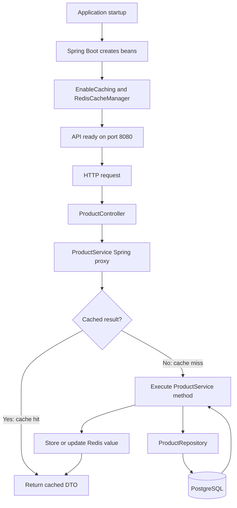
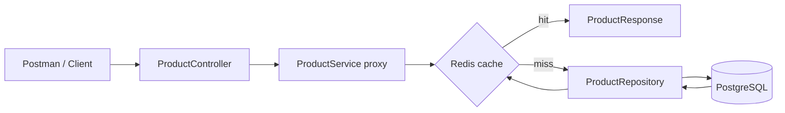
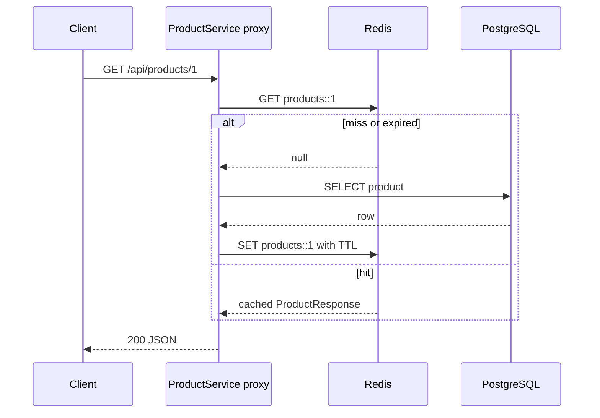

# Spring Boot Redis Cache Demo

Beginner-friendly Product Management REST API using Java 21, Spring Boot 3.4, PostgreSQL, Redis 7, and Lombok. It demonstrates cache misses, hits, refreshes, evictions, list invalidation, and TTL expiration.

Lombok is used only to reduce repetitive boilerplate: `@Getter` and `@Setter` on the entity, `@NoArgsConstructor` and `@AllArgsConstructor` for entity construction, `@RequiredArgsConstructor` for constructor-based dependency injection, and `@Slf4j` for logging. Lombok generates these methods during compilation; the application still uses ordinary Spring constructor injection at runtime.

## Setup

### Prerequisites

- Java 21 (`java -version`)
- Maven 3.9 or newer (`mvn -version`)
- Docker, or locally installed PostgreSQL and Redis

### 1. Create the PostgreSQL database

Create PostgreSQL and the database, then start Redis. The application defaults to user `postgres` and password `postgres`; override them with `DB_USERNAME`, `DB_PASSWORD`, and `DB_URL` when needed.

```sql
CREATE DATABASE redis_demo;
```

The default JDBC URL is `jdbc:postgresql://localhost:5432/redis_demo`. For a different PostgreSQL setup:

```powershell
$env:DB_URL="jdbc:postgresql://localhost:5432/redis_demo"
$env:DB_USERNAME="postgres"
$env:DB_PASSWORD="your-password"
```

### 2. Start Redis

```bash
docker run -d --name redis-cache -p 6379:6379 redis:7
```

Check that Redis is available:

```bash
redis-cli PING
```

Expected result: `PONG`.

### 3. Build and run the application

```bash
mvn clean test
mvn spring-boot:run
```

The API listens on `http://localhost:8080`. Hibernate creates or updates the `products` table for this educational project. For production, use versioned migrations such as Flyway and set `ddl-auto=validate`.

### 4. Stop the local Redis container

```bash
docker stop redis-cache
```

The container can be started again with `docker start redis-cache`.

## Application execution flow

On startup, Spring Boot creates the web server, JPA repository, Redis connection factory, and `RedisCacheManager`. `@EnableCaching` registers the cache interceptor that wraps `ProductService` in a Spring-managed proxy.

For a request, the normal execution sequence is:

1. Postman sends an HTTP request to `ProductController`.
2. Spring validates the request body when creating or updating a product.
3. The controller delegates to `ProductService`.
4. The cache proxy checks Redis for methods annotated with `@Cacheable`.
5. A cache hit returns the cached `ProductResponse` without executing the service method or querying PostgreSQL.
6. A cache miss executes the service method, which calls `ProductRepository`.
7. PostgreSQL returns the entity; the service maps it to a DTO.
8. Spring stores the DTO in Redis with the configured TTL and returns the HTTP response.
9. Write operations update PostgreSQL first, then refresh or evict the affected cache entries.



## Architecture and cache flow



Spring Cache annotations are intercepted by a Spring-managed proxy. Consequently, a `@Cacheable` hit returns before the target method executes. Keep cached methods in a separate Spring bean when one cached method needs to call another; self-invocation bypasses the proxy.

## Endpoints

| Method | URL | Result |
|---|---|---|
| POST | `/api/products` | 201 and created product |
| GET | `/api/products/{id}` | 200 or 404 |
| GET | `/api/products` | 200 and list |
| PUT | `/api/products/{id}` | 200 and updated product, or 404 |
| DELETE | `/api/products/{id}` | 204, or 404 |

Example request body:

```json
{"productName":"Mechanical Keyboard","price":89.99}
```

Responses use DTOs rather than exposing JPA entities. `ProductResponse` implements `Serializable`; the configured JSON Redis serializer makes values readable and avoids relying on the default JDK serializer, but serializability remains a useful compatibility property.

## What is cached

| Cache | Key | TTL | Annotation |
|---|---|---:|---|
| `products` | `products::{id}` | 10 minutes | `@Cacheable`, `@CachePut`, `@CacheEvict` |
| `productList` | `productList::all` | 2 minutes | `@Cacheable`, list eviction |

Create, update, and delete operations evict the list cache. Update also refreshes the individual product cache; delete evicts it. This prevents a previously cached list or item from returning stale data. TTL begins when Redis stores or refreshes the key. After expiration, the next request misses and reloads PostgreSQL.



## Redis CLI verification

Use non-destructive inspection commands against a local Redis instance:

```text
redis-cli PING
redis-cli SCAN 0 MATCH products::* COUNT 100
redis-cli EXISTS products::1
redis-cli TTL products::1
redis-cli DBSIZE
redis-cli DEL products::1
```

`PING` should return `PONG`; `SCAN` lists matching keys; `EXISTS` returns 1 or 0; `TTL` returns remaining seconds (or a negative status for no expiry); `DBSIZE` reports key count; `DEL` removes only the named demonstration key. Avoid `FLUSHALL` on shared Redis servers.

## Postman teaching scenarios

Use `Content-Type: application/json` and `http://localhost:8080` as the base URL.

### Create sample data

Send this request twice with different product names so the list and individual-key behavior can be observed:

```http
POST http://localhost:8080/api/products
Content-Type: application/json
```

```json
{
  "productName": "Mechanical Keyboard",
  "price": 89.99
}
```

Expected response: HTTP `201 Created`, a JSON product, and a `Location` header such as `/api/products/1`.

### Cache-hit and cache-miss scenario

1. Send `GET /api/products/1` for the first time. Expect HTTP 200, a Hibernate `SELECT`, and Redis key `products::1`.
2. Send the same request again. Expect HTTP 200 with the same data, no `CACHE MISS` log, and no new SQL query.
3. Run `redis-cli TTL products::1` to see the remaining lifetime.

### Update and refresh scenario

```http
PUT http://localhost:8080/api/products/1
Content-Type: application/json
```

```json
{
  "productName": "Updated Keyboard",
  "price": 99.00
}
```

The method always executes because it uses `@CachePut`. Expect PostgreSQL `UPDATE`, the refreshed `products::1` value, and eviction of `productList::all`. A following GET should return `Updated Keyboard` without another SQL query.

### List-cache scenario

1. Send `GET /api/products`. The first request queries PostgreSQL and creates `productList::all`.
2. Send it again. The second request is served from Redis.
3. Create, update, or delete a product. The list cache is evicted.
4. Send `GET /api/products` again. PostgreSQL is queried and the new list is cached.

### Delete and missing-resource scenario

1. Send `DELETE /api/products/1`. Expect HTTP `204 No Content`; both the item cache and list cache are evicted.
2. Send `GET /api/products/1`. Expect HTTP `404 Not Found` with a JSON error response.
3. Send `PUT /api/products/999` for a nonexistent product. Expect HTTP `404` and no incorrect Redis entry.

### TTL and stale-data scenario

Use `TTL` to monitor expiration. The `products` cache expires after 10 minutes and `productList` after 2 minutes. After expiration, the next GET is a cache miss and reloads PostgreSQL. If a row is changed directly in PostgreSQL, Redis can return stale data until the cache entry is evicted, refreshed, or expires; application writes should therefore go through the service layer.

| ID | Request | Expected observation |
|---|---|---|
| TC01 | `POST /api/products` with the example body | 201; PostgreSQL `INSERT`; list cache is invalidated |
| TC02 | First `GET /api/products/1` | 200; `CACHE MISS` log and SQL `SELECT`; Redis gets `products::1` |
| TC03 | Repeat TC02 | 200; no service miss log and no SQL; Redis hit |
| TC04 | `GET /api/products/2` | Separate `products::2` key |
| TC05 | `PUT /api/products/1` with `{"productName":"Updated","price":99.0}` | 200; SQL update; key 1 refreshed and list evicted |
| TC06 | Repeat TC02 | Updated value comes from the refreshed cache |
| TC07 | `DELETE /api/products/1` | 204; SQL delete; item and list keys evicted |
| TC08 | `GET /api/products/1` | 404; miss reaches DB and finds no row; no bad cache entry |
| TC09 | First `GET /api/products` | SQL query; `productList::all` populated |
| TC10 | Repeat TC09 | 200 from list cache; no SQL |
| TC11 | Create another product, then TC09 | Create evicts list; next list request queries DB and includes it |
| TC12 | Wait for TTL or use a short-lived test configuration, then GET | Cache miss and DB reload |
| TC13 | `PUT /api/products/999` | 404; no cache refresh or incorrect entry |
| TC14 | Stop Redis and call a cached endpoint | Default Redis cache manager surfaces the connection failure; availability policy should be chosen explicitly for production |
| TC15 | Restart only Spring Boot while Redis remains running | Unexpired Redis keys remain and can serve hits |
| TC16 | Change a row directly in PostgreSQL | Redis may return stale data until update/eviction or TTL; direct writers must publish invalidations or use a shorter TTL |

Typical Hibernate evidence is `select ... from products where id=?`, followed by no SQL on a cache hit. Exact SQL formatting varies by Hibernate version.

## Tests

```bash
mvn test
```

`ProductServiceTest` uses Mockito for repository behavior and a real Spring cache proxy backed by `ConcurrentMapCacheManager`, so it verifies interception, cache hits, refreshes, and eviction without requiring external services. Mockito alone cannot prove Spring Cache interception. For a full infrastructure test, run PostgreSQL and Redis (or add Testcontainers) and use the normal `RedisCacheConfig` with `@SpringBootTest`.

## Project structure

```text
src/main/java/com/durgasoft/redis/
├── config/RedisCacheConfig.java
├── controller/ProductController.java
├── dto/ProductRequest.java, ProductResponse.java
├── entity/Product.java
├── exception/ProductNotFoundException.java, GlobalExceptionHandler.java
├── repository/ProductRepository.java
├── service/ProductService.java
└── RedisCacheApplication.java
```
